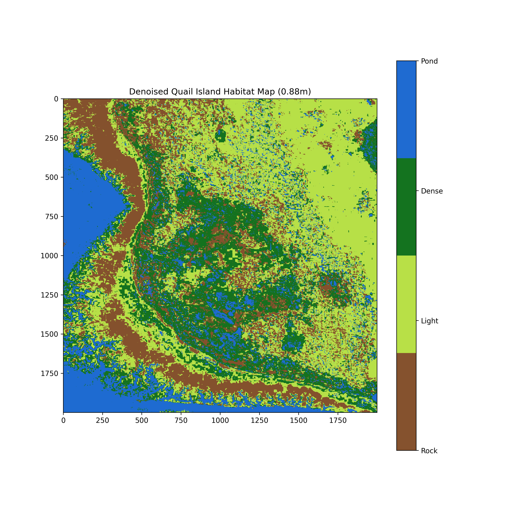

# frog-microhabitat-segmentation
Multi-scale aerial &amp; satellite micro-habitat segmentation pipeline (RGB VARI/ExG + GMM and Sentinel-2 NDVI) for Western Port Bay &amp; Quail Island, supporting agent-based amphibian thermoregulation modelling (MATRIX Annals).

# Aerial & Satellite Micro-Habitat Segmentation for Amphibian Movement Modelling

Geospatial remote-sensing workflows developed for the study:  
**"A mathematical investigation of thermoregulatory drivers for frog movement and emergent behaviour"** *(Accepted, MATRIX Annals)*.

This repository provides two complementary landscape classification approaches across **Quail Island** and **Western Port Bay, Victoria, Australia** to generate discrete micro-habitat matrices (`Pond`, `Sun-heated/Rock`, `Light Vegetation`, `Dense Vegetation`) for agent-based thermoregulation modelling of the Growling Grass Frog (*Ranoidea raniformis*):

1. **Sub-Metre RGB Unsupervised Segmentation (`VARI` + `ExG` + `GMM`):** High-resolution (~0.88 m/px) classification featured in Sections 2.4 and 3.4 of the paper.
2. **Multi-Spectral `NDVI` & Custom Tile-Stitching Pipeline:** 10 m Sentinel-2 Near-Infrared (`NDVI`) baseline classification via Digital Earth Australia (DEA) and custom-zoom XYZ aerial tile stitching for Western Port Bay.

---

## Methodology Comparison

| Pipeline | Imagery Source | Spatial Resolution | Spectral Features | Classification Method | Output |
| :--- | :--- | :--- | :--- | :--- | :--- |
| **Quail Island RGB** *(Paper Workflow)* | ArcGIS World Imagery (`export` REST API) | `~0.88 m/px` (`2000×2000 px`, `EPSG:4326`) | `R, G, B` + `VARI` + `ExG` | 4-component Gaussian Mixture Model (`GMM`) + `3×3` modal denoising | `quail_habitat_matrix.h5` |
| **Western Port Aerial Stitcher** | ArcGIS / Google XYZ Slippy Tiles | Configurable (`~30 cm` to `1.2 m/px`, Zoom 17–19) | `R, G, B` | Georeferenced GeoTIFF mosaic builder for downstream classification | `westernport_aerial.tif` |
| **Sentinel-2 NDVI Baseline** | Digital Earth Australia (`ga_s2am_ard_3` STAC) | `10 m/px` (`EPSG:3577` Australian Albers) | `nbart_red`, `nbart_nir_1` (`NDVI`) | Temporal median composite + threshold binning (`<0`, `<0.2`, `<0.5`, `≥0.5`) | `landscape_matrix.h5` & `.tif` |

---

## Spectral Indices Used

* **Visible Atmospherically Resistant Index (`VARI`):**
  $$\text{VARI} = \frac{G - R}{G + R - B}$$
  Separates open water bodies from terrestrial substrates using visible RGB bands.
* **Excess Green Index (`ExG`):**
  $$\text{ExG} = 2G - R - B$$
  Enhances contrast between high-chlorophyll dense vegetation (mangroves) and sparse saltmarsh/light vegetation.
* **Normalized Difference Vegetation Index (`NDVI`):**
  $$\text{NDVI} = \frac{\text{NIR} - \text{Red}}{\text{NIR} + \text{Red}}$$
  Used in the 10 m Sentinel-2 baseline workflow to separate water (`NDVI < 0`), bare/rock surfaces (`0 ≤ NDVI < 0.2`), light vegetation (`0.2 ≤ NDVI < 0.5`), and dense vegetation (`NDVI ≥ 0.5`).

---

## Installation & Usage

```bash
git clone [https://github.com/](https://github.com/)<your-username>/frog-microhabitat-segmentation.git
cd frog-microhabitat-segmentation
pip install -r requirements.txt
```

### 1. Run the Quail Island High-Resolution RGB + GMM Pipeline (Paper Fig. 10)
```bash
python pipelines/01_quail_island_rgb_gmm.py
```

### 2. Stitch Custom-Resolution Aerial Imagery for Western Port Bay
```bash
python pipelines/02_westernport_tile_stitcher.py
```

### 3. Run the 10 m Sentinel-2 NDVI Baseline Workflow
```bash
python pipelines/03_sentinel2_ndvi_baseline.py
```
---



## Related Code & Citation

* **Agent-Based Model (MATLAB & NicheMapR):** [clairemiller/Hop-Stop-Drop](https://github.com/clairemiller/Hop-Stop-Drop)

If you use these pipelines, please cite:
> Arroyo-Vázquez, R. B., Dowling, C., Flegg, J. A., George, A., Germano, D., Hao, T., Mendoza, V. M., Miller, C., Subhadarshini, S., & West, M. (2026). *A mathematical investigation of thermoregulatory drivers for frog movement and emergent behaviour*. MATRIX Annals (Accepted).
